<p align="center"></p>
<h1 align="center">Context Layer</h1>
<p align="center">A workspace for exploring data, testing models and making evidence-led decisions.</p>

Context Layer brings CSV preparation, dataset exploration, governed SQL, product networks, bounded machine learning experiments, weekly sales projections and evidence-linked decision briefs into one authenticated workspace. It builds on Alper Çamlı's metadata and governance platform, with adapted retrieval, safety and export components from adviSU and network methods from PoliEcoTRNetSci.

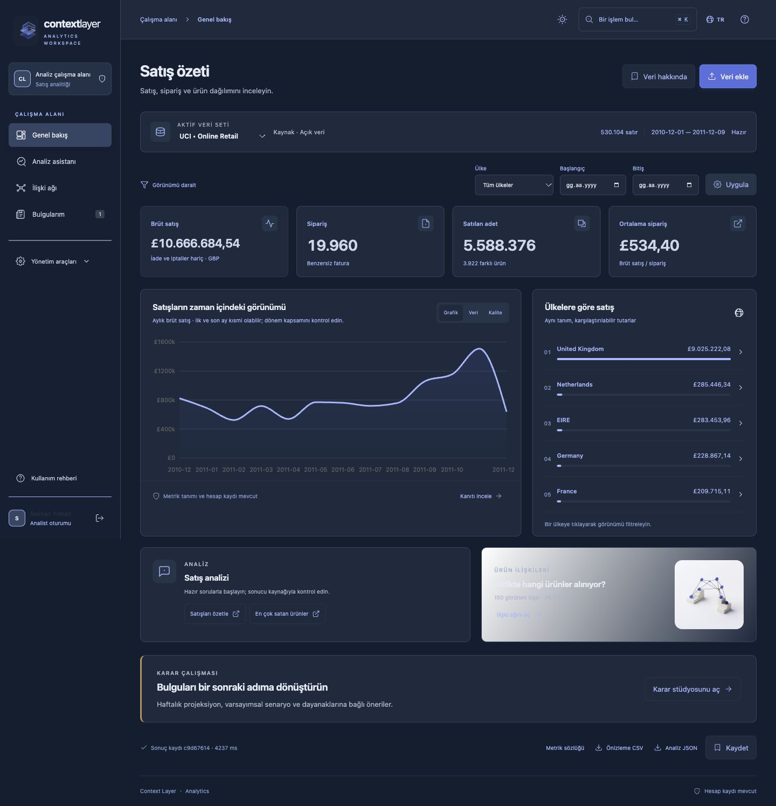

<details><summary>Light appearance</summary>

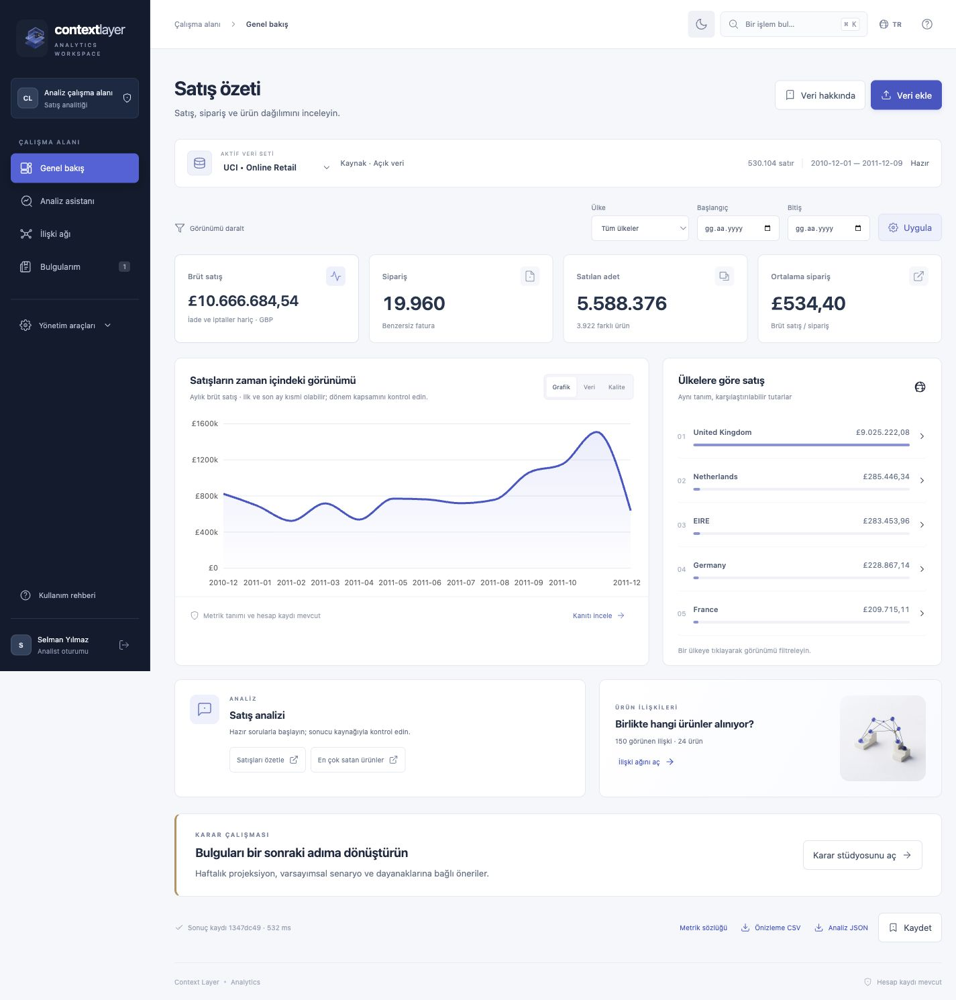

</details>

## Explore, investigate, keep the evidence

| Workspace | What you can do |
|---|---|
| **Prepare data** | Profile any bounded CSV or Parquet schema, preserve leading-zero identifiers, see decimal-comma and date-pattern diagnostics, map retail fields, choose decimal/date conversions explicitly, preview quality and totals, and remove duplicates before import. |
| **Model studio** | Choose a target and features, use random/group/time splits, compare baseline/forest/linear candidates with training CV, inspect held-out metrics (including log loss, Brier and calibration error for classifiers), and save/export an owner-scoped model card. |
| **Decision studio** | Inspect ranked investigations and their evidence, compare weekly forecasts with a naive benchmark, declare price/volume/budget scenarios, and reopen or export saved decision briefs. |
| **Overview** | Inspect gross sales, orders, units and average order value. Filter dates/countries, inspect monthly trends, review schema and data quality. |
| **Analysis** | Ask bounded analytics questions, inspect formulas and calculation evidence, search metric/schema context, and use the read-only SQL lab. |
| **Relationships** | Explore invoice co-purchase or country-profile similarity, select products, inspect communities/centralities, and switch to accessible data tables. |
| **Change over time** | Compare before/focus/after windows using a shared product universe, new/lost relationships, Jaccard overlap, concentration and descriptive intervals. |
| **Findings** | Save, reopen, rerun, compare, archive and restore your analyses. Export query results to CSV/Excel and calculation evidence to JSON. |

The interface supports Turkish and English, command search, keyboard navigation and responsive layouts. Light and navy/charcoal appearances follow the system preference, with a manual session toggle. Six Gemini raster assets and 37 geometry-only SVGs form the visual family, including the product icon and custom workspace, language, dataset and utility controls. Illustrations remain separate from analytic charts.

### Analysis assistant

An optional **Llama 3.3 70B** planner uses the Hugging Face inference router through the adapted adviSU provider transport. It maps a question to an allowlisted intent within the current filters. Facts and numbers come from the local calculation engine; the model cannot execute arbitrary SQL or Python. The question and a static routing policy are sent only when the user enables Llama. Dataset rows and results are not sent by this routing mode. The separate decision-studio opt-in below sends minimized numerical aggregates and methodology notes, without raw rows or product/country labels.

**Current live-service limitation:** the configured account returned HTTP 402 (inference credit required). The app handles this explicitly and preserves the standard calculated answer. A successful live model response and model accuracy benchmark have **not** been verified. Fifty offline plan-contract fixtures test schema/executor behavior; they do not measure model accuracy.

<details>
<summary>View the analysis assistant</summary>

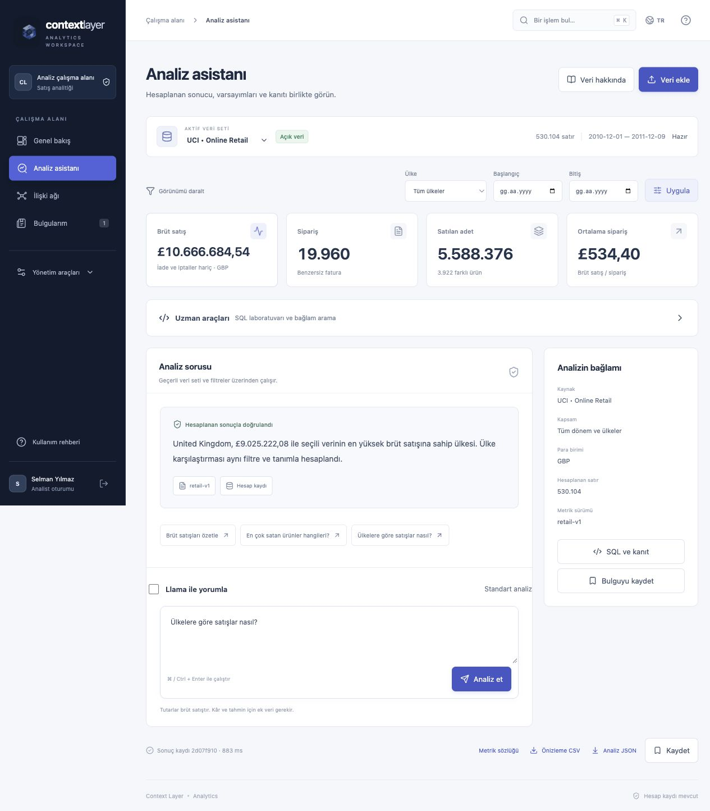

</details>

### From analysis to a decision brief

The **Decision studio** combines measured gross sales, market concentration,
co-purchase evidence and a one-week sales projection. Each investigation has
an explanation, explicit missing evidence, a three-step decision sequence and
links to the actual calculation or chart. Its support score is a published
checklist, not a probability of correctness or an expected return.

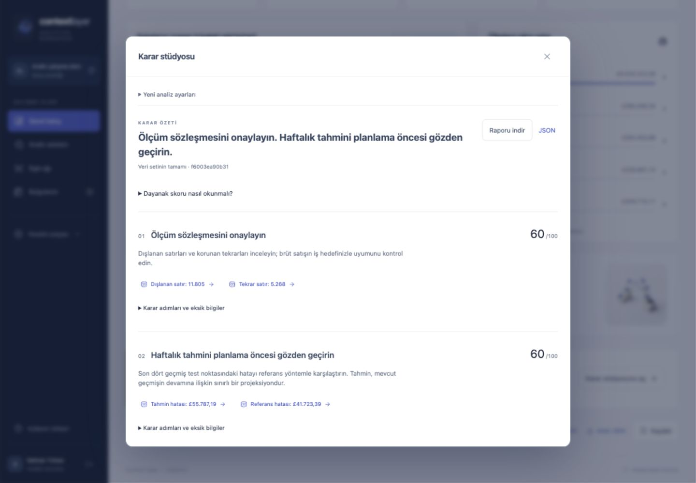

Forecasts compare registered baselines (last week, seasonal naive when two
seasons exist, drift, trailing means, exponential smoothing, damped Holt) by
one-step rolling error on development origins only; a final window of the
last origins is evaluated afterwards for every method and never selects one.
The UI shows MAE/MASE against the naive benchmark, including when the
selected method performs worse. The residual band's scaling is chosen on
development origins with radii built from earlier residuals only (finite-sample
conformal quantile); its development and final-window coverage are shown and
it remains labelled uncalibrated. At least 16 complete weeks are required.
Price and volume scenarios use declared assumptions; gross-sales delta is
separate from budget, profit and causal impact.

Every brief carries a typed analyst narrative — fact, calculation, inference,
assumption, recommendation, limitation — in which each sentence links to the
calculation it rests on. The local renderer always produces it; an optional
Llama narrative must return the same typed JSON over an evidence packet and is
accepted only when every evidence id exists and every number equals a cited
value. Missing evidence is reported as unknown, never as zero.

An optional Llama step receives a bounded XML evidence bundle and methodology
notes retrieved with the adapted adviSU BM25 kernel. Strict validation permits
only existing candidate IDs and rationale codes. The local engine controls
numbers, scores, ordering and explanations; provider failure preserves the
local brief. XML structure and schema validation do not establish model accuracy.
The current live provider remains blocked by HTTP 402.

Briefs are saved per signed-in identity. Export JSON calculations, a Markdown
report or the minimized XML model context. The [public UCI report](docs/evidence/phase10/uci-decision.md)
and [evaluation report](docs/phases/PHASE_10_REPORT.md) show actual results and limits.

### Product networks and time windows

Co-purchase edges represent products on the same invoice. Similarity edges compare country sales profiles; they do not establish causality. The visible graph is bounded to 24 products and 150 edges. Temporal comparison uses one shared universe with up to 276 pairs. Methods, filters, sample coverage and evidence are available next to the result.

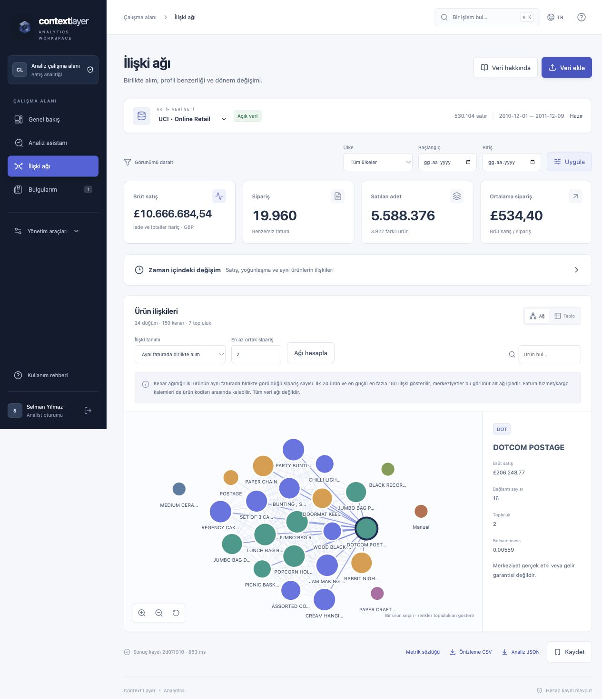

<details>
<summary>View the period comparison</summary>

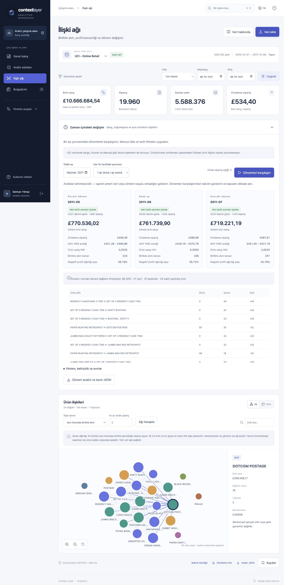

</details>

<details>
<summary>View saved findings and the mobile layout</summary>

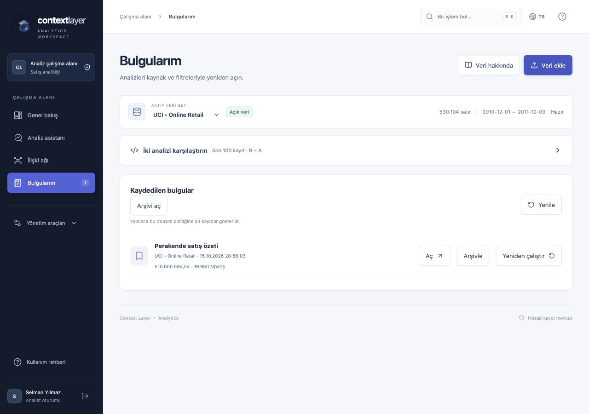

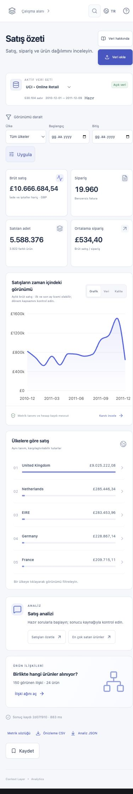

</details>

### Prepare data and compare models

Explicit mappings and a source/recipe receipt connect the import preview to the
actual calculation. Draft transformations can be reset; changing a field or
option invalidates the previous preview.

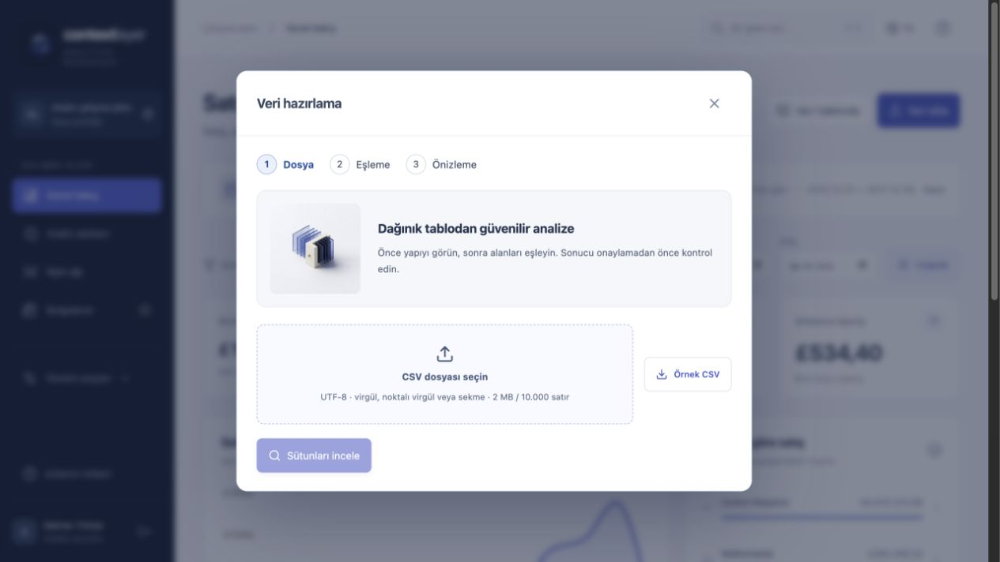

The model studio compares fixed-budget baseline, Random Forest and linear
candidates using three training folds. Preprocessing is fitted inside each
fold. Optional numeric-only SMOTE resamples training data only. A separate
20% holdout is evaluated after selection; group and chronological strategies
are available for suitable data. Saved cards contain split/source/runtime
receipts, metrics and limitations. Raw training CSV and fitted executable
models are not persisted.

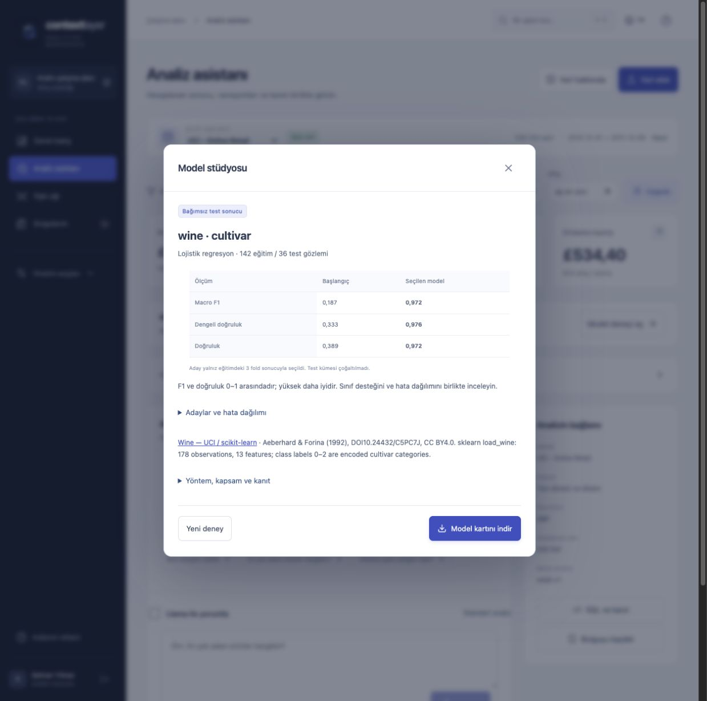

<details><summary>Original visual identity and responsive model studio</summary>

<p>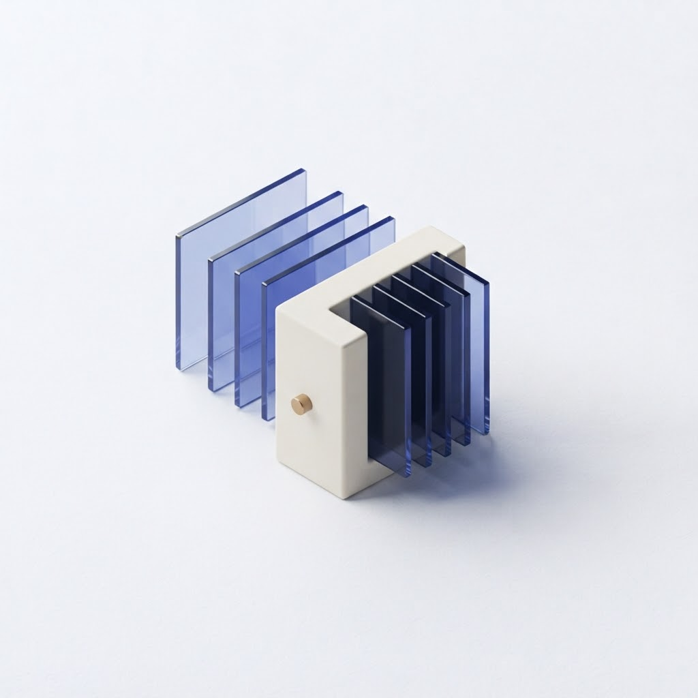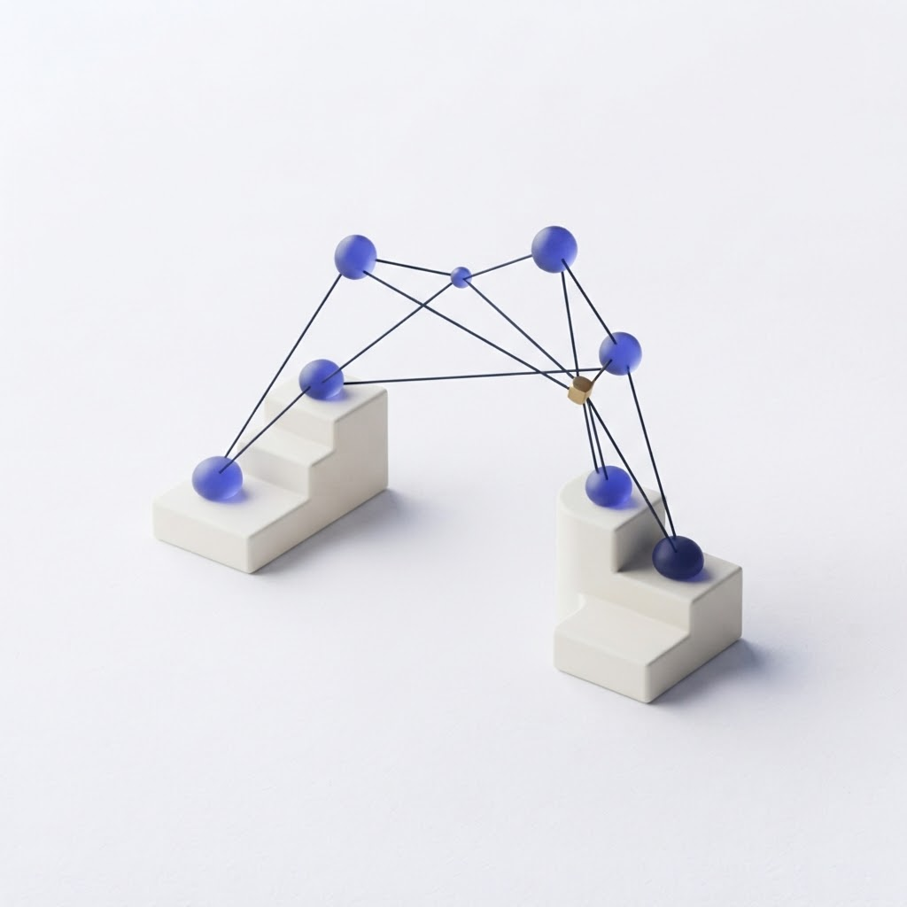</p>

Six Gemini raster assets and 37 generated geometry vectors
form the product's visual family. New illustrations orient the preparation,
model and relationship entrances; calculated charts and results retain their
own clear visual language. [Asset provenance](core/web/src/workbench/assets/PROVENANCE.md).

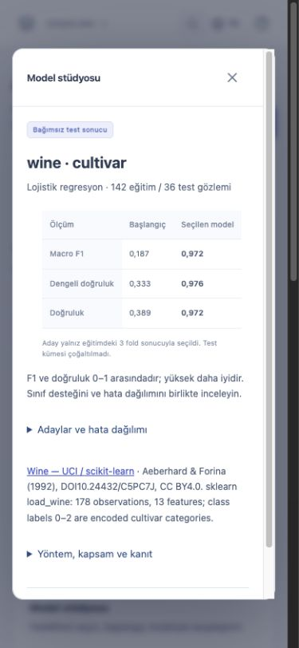

</details>

## Try it locally

Requirements: **Python 3.12**, **Node.js 22+** (tested with 24), and **PostgreSQL 16**. On macOS, the launcher uses the Homebrew PostgreSQL installation, creates an isolated loopback database, prepares datasets, builds the UI and starts the app. It does not require Docker or change other projects' containers.

```sh
./deploy/phase1/start.sh
```

Open **http://127.0.0.1:8123/app/**. Local fixture accounts: `selman` or `alper`, password `analiz-demo`. `viewer` uses the same password and has no analyst role. These are development fixtures, not a production identity deployment. Ports: app 8123, identity 8188, PostgreSQL 5549. Other environments can override `CONTEXT_NODE_BIN` and `CONTEXT_PG_BIN`; inspect the launcher before configuring a production environment.

To configure Llama, set `HF_TOKEN` and optionally `HF_MODEL=meta-llama/Llama-3.3-70B-Instruct` on the server, then restart it. The local launcher also supports an ignored mode-0600 `analysis/.local/hf-provider.json` with `token` and `model` keys. Never put a credential in browser code or Git. Inference requires appropriate Hugging Face permissions and credits.

### Data included in the experience

- **Retail sample:** deterministic synthetic data, independent Decimal oracle, £21,405 gross sales / 180 invoices. Useful for checking filters and calculations.
- **UCI Online Retail:** historical 2010–2011 public data by Daqing Chen, [DOI 10.24432/C5BW33](https://doi.org/10.24432/C5BW33), CC BY 4.0. Preparation downloads the official source; the full dataset is not committed. Of 541,909 source rows, 530,104 positive eligible invoice lines contribute **£10,666,684.54 / 19,960 invoices**.
- **Private CSV:** bounded generic profiling, explicit owner-scoped retail field mapping and import, UTF-8, up to 2 MB / 10,000 rows. Retail metrics require GBP and invoice-line grain; unit prices accept up to four decimal places.
- **ML examples:** original measured records from UCI Wine (178 observations, 13 features, CC BY 4.0) and the scikit-learn Diabetes benchmark (442 observations, 10 features). Source notes and SHA-256 hashes are in [ML provenance](analysis/data/ML_PROVENANCE.json). Model experiments accept 100–3,000 observations and up to 30 selected features.

Sales exclude returns/cancellations and are rounded to pence per invoice line. They are **gross sales**, not net revenue or profit. Duplicate lines and postage/service/manual invoice lines are retained and disclosed. Boundary months may be partial. Source definitions and quality counts stay available inside the app.

## Trust and reproducibility

The workspace reuses existing OIDC sessions, CSRF checks, roles and audit logging. Dataset/run/query/experiment ownership is checked server-side. SQL uses the original validator plus a narrow AST/function policy, read-only DuckDB, disabled external access and execution/output limits. CSV/Excel exports protect string cells against spreadsheet formulas while preserving numeric values.

All analytic worker routes share subject/global admission, including PostgreSQL advisory permits across core processes using the same database. Run archival is reversible. Recipe v4 evidence binds dataset identity, filters, computed artifacts and a calculation-source/dependency fingerprint. Historic v1/v2/v3 results are retained rather than rewritten.

This is a **locally verified development release**. Production identity/tenant RLS, dataset/query retention, OS resource isolation, large-scale load evidence and task-based user research remain open gates. The existing MCP/live execution governance path and deterministic KB generator are preserved.

## Verification and project map

- [Test walkthrough](docs/phases/TEST_GUIDE.md) — expected values and UI scenarios.
- [Preparation release](docs/phases/PHASE_5_REPORT.md), [model experiment release](docs/phases/PHASE_6_REPORT.md).
- [Phase 4 release report](docs/phases/PHASE_4_REPORT.md) — actual checks, observations and remaining gates.
- [Source reuse ledger](docs/phases/REUSE_LEDGER.md) — exact adaptations, runtime status and attribution.
- [Architecture and setup](docs/PLATFORM_OVERVIEW.md), [core service](core/README.md), [specifications](specs/spec-index.md).
- [Prioritized next work](docs/phases/NEXT_BACKLOG.md), [handoff](progress.md), [security](SECURITY.md).

```sh
.venv/bin/python -m pytest analysis/tests -q
npm --prefix core run build
```

Core integration tests use Docker-backed connector fixtures. Local tests, browser checks, source attribution and measured worker timings are under `docs/evidence/verification/phase10-*`. The latest CI receipt and acceptance limits are in [progress.md](progress.md) and the [phase 10 report](docs/phases/PHASE_10_REPORT.md). Offline schema tests do not measure live-model accuracy.

## Source projects

Built on [AlperCamli/DataAnalyticsTool](https://github.com/AlperCamli/DataAnalyticsTool), with actual adaptations from [mesely/adviSU](https://github.com/mesely/adviSU) and [mesely/PoliEcoTRNetSci](https://github.com/mesely/PoliEcoTRNetSci). [Influencer stacking/SMOTE/RF](https://github.com/mesely/Influencer-Category-and-Like-Prediction-Stacking-SMOTE-RF) contributes adapted train-only preprocessing and log-error functions to the model studio. Its notebook models and historical scores are not imported; models are fitted and measured locally. [SNIPS intent detection](https://github.com/mesely/NLP-Intent-Detection-with-SNIPS-Dataset) remains researched but deferred until an analytics-intent baseline shows a measured need. Pinned commits, symbols and hashes are recorded in the source ledger.
