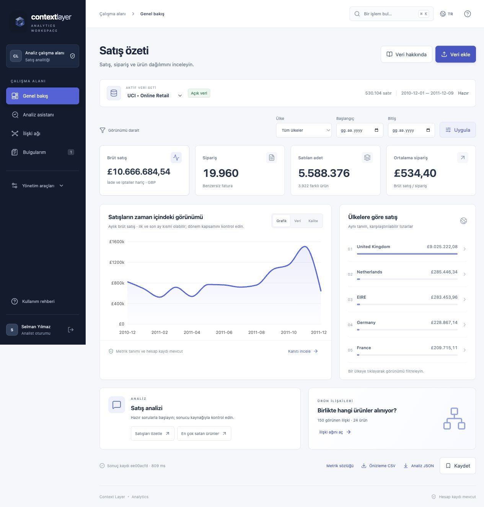

<p align="center"></p>
<h1 align="center">Context Layer</h1>
<p align="center">A workspace for sales analysis, relationship networks and traceable findings.</p>

Context Layer brings dataset exploration, governed SQL, product networks and reproducible analysis into one authenticated workspace. It builds on Alper Çamlı's metadata and governance platform, with adapted retrieval, safety and export components from adviSU and network methods from PoliEcoTRNetSci.



## Explore, investigate, keep the evidence

| Workspace | What you can do |
|---|---|
| **Overview** | Inspect gross sales, orders, units and average order value. Filter dates/countries, inspect monthly trends, review schema and data quality. |
| **Analysis** | Ask bounded analytics questions, inspect formulas and calculation evidence, search metric/schema context, and use the read-only SQL lab. |
| **Relationships** | Explore invoice co-purchase or country-profile similarity, select products, inspect communities/centralities, and switch to accessible data tables. |
| **Change over time** | Compare before/focus/after windows using a shared product universe, new/lost relationships, Jaccard overlap, concentration and descriptive intervals. |
| **Findings** | Save, reopen, rerun, compare, archive and restore your analyses. Export query results to CSV/Excel and calculation evidence to JSON. |

The interface supports Turkish and English, command search, keyboard navigation and responsive layouts. Original Gemini artwork and four custom navigation vectors complement a restrained navy/cobalt visual system; illustrations are separate from analytic charts.

### Analysis assistant

An optional **Llama 3.3 70B** planner uses the Hugging Face inference router through the adapted adviSU provider transport. It maps a question to an allowlisted intent within the current filters. Facts and numbers come from the local calculation engine; the model cannot execute arbitrary SQL or Python. The question and a static routing policy are sent only when the user enables Llama. Dataset rows and results are not sent.

**Current live-service limitation:** the configured account returned HTTP 402 (inference credit required). The app handles this explicitly and preserves the standard calculated answer. A successful live model response and model accuracy benchmark have **not** been verified. Fifty offline plan-contract fixtures test schema/executor behavior; they do not measure model accuracy.

<details>
<summary>View the analysis assistant</summary>


</details>

### Product networks and time windows

Co-purchase edges represent products on the same invoice. Similarity edges compare country sales profiles; they do not establish causality. The visible graph is bounded to 24 products and 150 edges. Temporal comparison uses one shared universe with up to 276 pairs. Methods, filters, sample coverage and evidence are available next to the result.


<details>
<summary>View the period comparison</summary>


</details>

<details>
<summary>View saved findings and the mobile layout</summary>


</details>

## Try it locally

Requirements: **Python 3.12**, **Node.js 22+** (tested with 24), and **PostgreSQL 16**. On macOS, the launcher uses the Homebrew PostgreSQL installation, creates an isolated loopback database, prepares datasets, builds the UI and starts the app. It does not require Docker or change other projects' containers.

```sh
./deploy/phase1/start.sh
```

Open **http://127.0.0.1:8123/app/**. Local fixture accounts: `selman` or `alper`, password `analiz-demo`. `viewer` uses the same password and has no analyst role. These are development fixtures, not a production identity deployment. Ports: app 8123, identity 8188, PostgreSQL 5549. Other environments can override `CONTEXT_NODE_BIN` and `CONTEXT_PG_BIN`; inspect the launcher before configuring a production environment.

To configure Llama, set `HF_TOKEN` and optionally `HF_MODEL=meta-llama/Llama-3.3-70B-Instruct` on the server, then restart it. The local launcher also supports an ignored mode-0600 `analysis/.local/hf-provider.json` with `token` and `model` keys. Never put a credential in browser code or Git. Inference requires appropriate Hugging Face permissions and credits.

### Data included in the experience

- **Retail sample:** deterministic synthetic data, independent Decimal oracle, £21,405 gross sales / 180 invoices. Useful for checking filters and calculations.
- **UCI Online Retail:** historical 2010–2011 public data by Daqing Chen, [DOI 10.24432/C5BW33](https://doi.org/10.24432/C5BW33), CC BY 4.0. Preparation downloads the official source; the full dataset is not committed. Of 541,909 source rows, 530,104 positive eligible invoice lines contribute **£10,666,684.54 / 19,960 invoices**.
- **Private CSV:** owner-scoped retail-schema import, UTF-8, up to 2 MB / 10,000 rows. Unit prices accept up to four decimal places.

Sales exclude returns/cancellations and are rounded to pence per invoice line. They are **gross sales**, not net revenue or profit. Duplicate lines and postage/service/manual invoice lines are retained and disclosed. Boundary months may be partial. Source definitions and quality counts stay available inside the app.

## Trust and reproducibility

The workspace reuses existing OIDC sessions, CSRF checks, roles and audit logging. Dataset/run/query ownership is checked server-side. SQL uses the original validator plus a narrow AST/function policy, read-only DuckDB, disabled external access and execution/output limits. CSV/Excel exports protect string cells against spreadsheet formulas while preserving numeric values.

All analytic worker routes share subject/global admission, including PostgreSQL advisory permits across core processes using the same database. Run archival is reversible. Recipe v4 evidence binds dataset identity, filters, computed artifacts and a calculation-source/dependency fingerprint. Historic v1/v2/v3 results are retained rather than rewritten.

This is a **locally verified development release**. Production identity/tenant RLS, dataset/query retention, OS resource isolation, large-scale load evidence and task-based user research remain open gates. The existing MCP/live execution governance path and deterministic KB generator are preserved.

## Verification and project map

- [Test walkthrough](docs/phases/TEST_GUIDE.md) — expected values and UI scenarios.
- [Phase 4 release report](docs/phases/PHASE_4_REPORT.md) — actual checks, observations and remaining gates.
- [Source reuse ledger](docs/phases/REUSE_LEDGER.md) — exact adaptations, runtime status and attribution.
- [Architecture and setup](docs/PLATFORM_OVERVIEW.md), [core service](core/README.md), [specifications](specs/spec-index.md).
- [Prioritized next work](docs/phases/NEXT_BACKLOG.md), [handoff](progress.md), [security](SECURITY.md).

```sh
.venv/bin/python -m pytest analysis/tests -q
npm --prefix core run build
```

Core integration tests require the test PostgreSQL environment described in the walkthrough. Latest logs are under `docs/evidence/verification/`; remaining Docker-dependent baseline checks are documented rather than reported as passing.

## Source projects

Built on [AlperCamli/DataAnalyticsTool](https://github.com/AlperCamli/DataAnalyticsTool), with actual adaptations from [mesely/adviSU](https://github.com/mesely/adviSU) and [mesely/PoliEcoTRNetSci](https://github.com/mesely/PoliEcoTRNetSci). [SNIPS intent detection](https://github.com/mesely/NLP-Intent-Detection-with-SNIPS-Dataset) and [Influencer stacking/SMOTE/RF](https://github.com/mesely/Influencer-Category-and-Like-Prediction-Stacking-SMOTE-RF) have detailed reuse and leakage reviews; their models have not yet been integrated or trained in this workspace. Pinned commits, symbols and hashes are recorded in the source ledger.
