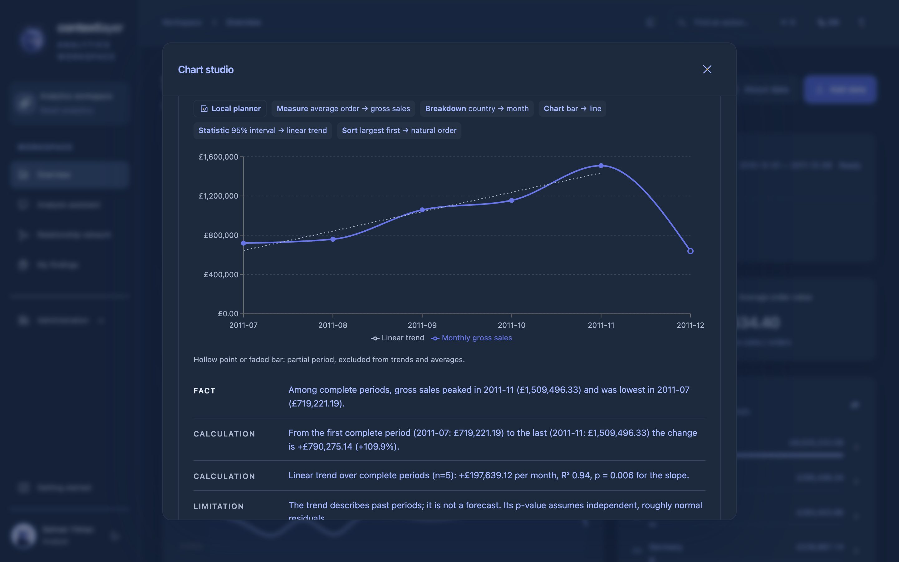
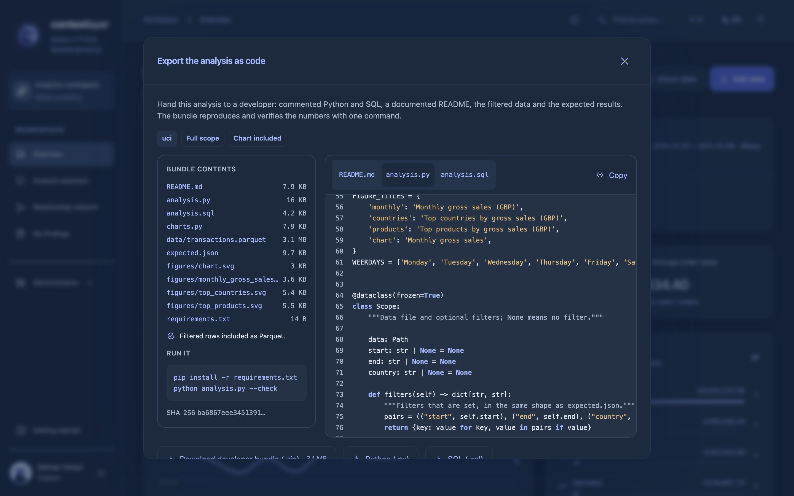
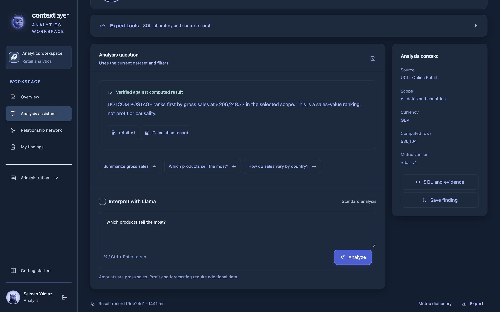
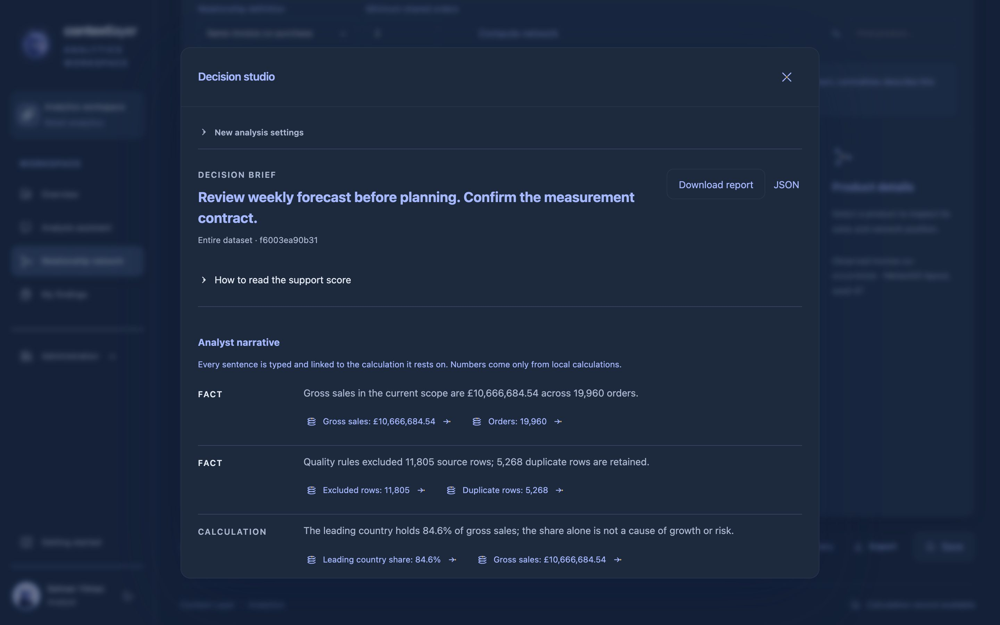
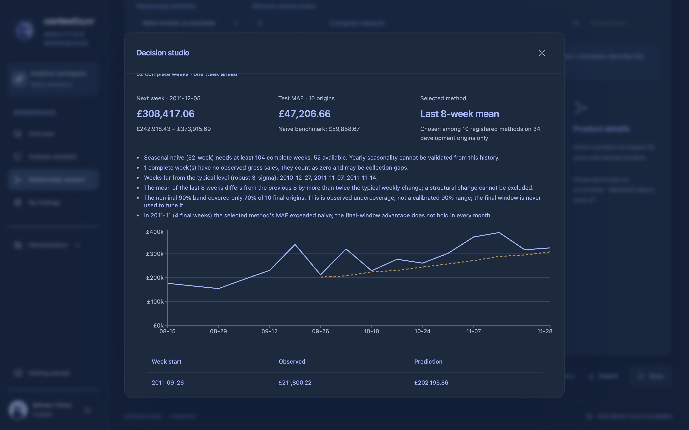
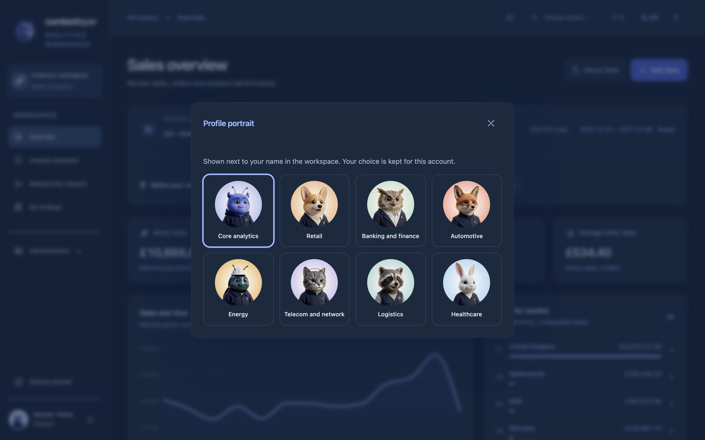
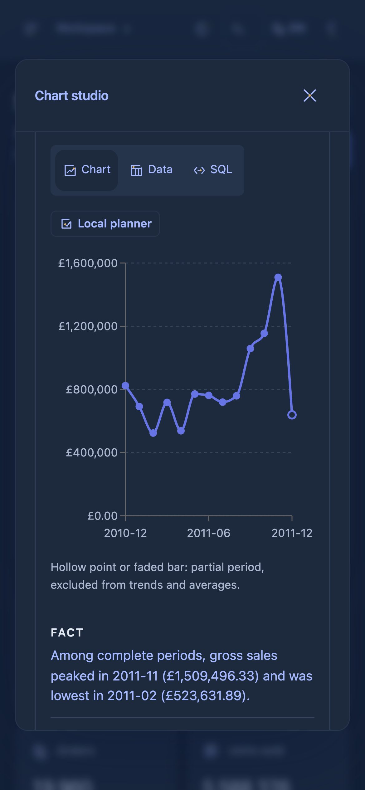
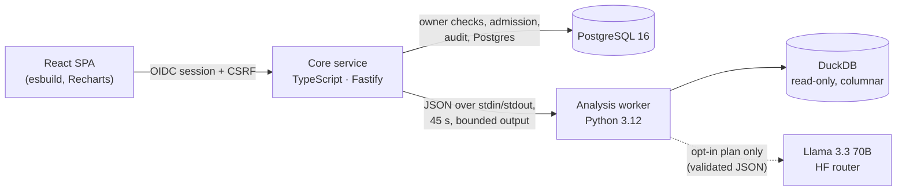

<p align="center"></p>
<h1 align="center">Context Layer</h1>
<p align="center"><b>Ask for any chart. Get the numbers, the evidence and the code.</b><br>
An analytics workspace where every figure is computed, checked and reproducible — and where a model may plan, but never invents a number.</p>
<p align="center"><a href="https://github.com/mesely/DataAnalyticsToolv2/actions/workflows/tests.yml"></a></p>

<p align="center"></p>

Context Layer brings data preparation, dataset exploration, governed SQL, product networks, bounded machine-learning
experiments, backtested forecasts, scenario briefs, a free-text **Chart Studio** and a **developer code hand-off**
into one authenticated workspace. It builds on Alper Çamlı's metadata and governance platform, with adapted retrieval,
safety and export components from adviSU and network methods from PoliEcoTRNetSci.

---

## Why it is different

| | What it means in practice | How it is enforced |
|---|---|---|
| **Numbers never come from a model** | Ask in your own words. A model (Llama 3.3 70B, opt-in) may only *plan* the analysis as a strict JSON spec; every number, interval and sentence is computed by the local engine. | Plans are schema-validated (enums, catalog countries, date ranges, no SQL, no prose); anything else falls back to a deterministic planner and says so on screen. |
| **Every figure has a receipt** | Formulas, filters, the executed SQL, dataset hash and a SHA-256 of the output sit next to each result. | Recipe/evidence binding per run; owner-scoped storage; audit log per action. |
| **Forecasts must beat naive — or say so** | Weekly projections are selected on development origins only and reported against a naive benchmark on an untouched final window, even when they lose. | On the two-season Online Retail II data, seasonal naive is selected and is 28.8 % below naive MAE on the 12-week final window; on the one-year data the UI shows the month where naive wins. |
| **Hand-off as code** | Export the current analysis — or a Chart Studio chart — as commented Python and DuckDB SQL with a README, the filtered rows as Parquet and pre-rendered figures. | `python analysis.py --check` recomputes everything and compares it with `expected.json` exactly; two exports of the same scope are byte-identical. |
| **Statistics with their assumptions** | 95 % t-intervals for averages, OLS trend with R² and p-value, ±2σ control bands, moving averages — each with the limitation that applies. | Intervals are offered only for means; asking for one on an observed total yields a control band and a warning, never a fake interval. |
| **Designed and measured** | One original, Gemini-generated visual language (52 glyphs, analyst portraits) and a measured design system. | DOM audit: Fitts, contrast, spacing, type scale, alignment and icon originality at 100 on 16 screen/theme/viewport combinations; Hick–Hyman 98–100. |

## From description to decision

| Question type | In Context Layer | Evidence you get |
|---|---|---|
| **Descriptive** — what happened? | KPIs, trends, country/product rankings, Chart Studio breakdowns by month, week, weekday, country or product | Metric definitions, executed SQL, data-quality counts |
| **Diagnostic** — why, where, with what? | Co-purchase and country-profile networks, three-window change over time, concentration, partial-period flags | Communities/centralities, Jaccard overlap, new/lost links |
| **Statistical** — how sure are we? | 95 % intervals of average order value, trend slope with R²/p/n, control bands | The assumption behind each statistic, stated with it |
| **Predictive** — what next? | One-week projection selected among 10 registered methods by rolling-origin backtest; bounded ML experiments (baseline / forest / linear, CV, holdout) | MAE/MASE vs naive, band coverage, model cards with calibration metrics |
| **Prescriptive** — what should we do? | Decision briefs: ranked investigations, price/volume scenarios, a typed narrative (fact → calculation → inference → recommendation → limitation) | A published support checklist (not a probability), missing evidence listed as unknown |

---

## Tour

### Overview

<p></p>
<details><summary>Light appearance</summary>
<p></p>
</details>

Gross sales, orders, units and average order value with one scope card for dataset and filters, monthly trend with
partial-period disclosure, and country rankings that filter the view. Turkish and English, command search (⌘K),
keyboard navigation, 44 px targets, dark and light appearances.

### Chart Studio — describe the chart you want

Type a request — *"last 6 months"*, *"compare Germany and France"*, *"average order by country, top 8, with a 95 %
interval"*, *"add a linear trend line"* — and refine it step by step. Each step shows exactly what changed, which
planner was used, the data, the SQL and a commentary written from the computed values.

<p></p>
<p></p>
<details><summary>Linear trend with R², p-value and the "descriptive, not a forecast" limitation</summary>
<p></p>
</details>

The local planner understands Turkish and English (metrics, breakdowns, chart types, relative and absolute periods,
quarters, Turkish country names, top-N, statistics, comparisons and removals). With Llama enabled and a provider
configured, the model proposes the spec instead; an invalid or unavailable plan falls back locally and the screen says
so. Interval whiskers that would fall below zero are cut at the axis, with the computed bounds kept in the Data tab.

### Hand the analysis to a developer

<p></p>
<details><summary>The generated Python, previewed in the app</summary>
<p></p>
</details>

The bundle is a working project, not a snippet:

```text
README.md          purpose, quick start, scope, metric definitions, data dictionary, expected results, recipes for changes
analysis.py        typed, documented functions; --data/--start/--end/--country/--out/--check; only dependency: duckdb
analysis.sql       the same queries in DuckDB SQL, parameters at the top (SET VARIABLE …)
charts.py          dependency-free SVG chart writer
data/              the filtered rows as Parquet (no customer identifiers)
expected.json      integer results at export time (pence and counts)
figures/           pre-rendered SVG figures (+ the exported Chart Studio chart)
```

```bash
pip install -r requirements.txt
python analysis.py --check      # ✓ 11 checks match expected.json
```

### Analysis assistant, networks and decisions

<p></p>
<p></p>
<p></p>
<details><summary>Backtested weekly forecast with diagnostics</summary>
<p></p>
</details>

### Analyst portraits

<p>


</p>

No letter avatars: each analyst picks a portrait for their business domain — retail, banking, automotive, energy,
telecom, logistics, healthcare — or the Context Layer mascot, which is also the product mark. All are original
Gemini (Nano Banana Pro) illustrations in one series; the choice is stored server-side per account
([provenance](core/web/src/workbench/assets/PROVENANCE.md)).

<p></p>

<details><summary>On a phone</summary>
<p> </p>
</details>

---

## Engineering



| Layer | Choice | Why |
|---|---|---|
| Aggregation | **DuckDB** (vectorised, columnar, embedded) | Group-bys over 530 k invoice lines in milliseconds, parameterised SQL, read-only files, no server to run |
| Statistics & ML | **Python** — pandas, NumPy, SciPy (special functions only on the hot path), scikit-learn, NetworkX | Established numerical libraries; imports are lazy so a chart request does not pay for the ML stack |
| Service boundary | **TypeScript / Fastify** | OIDC sessions, CSRF, roles, owner checks, audit and admission control in one typed layer; one worker subprocess per request isolates analysis faults |
| UI | **React** + Recharts, no UI kit | A design system measured in the DOM (type scale, 4 px rhythm, 44 px targets, WCAG contrast) and an original glyph family |

**Measured worker latency** (full subprocess per request: interpreter start, imports, DuckDB, JSON; public UCI data,
one thread, small samples — not an SLA; [receipt](docs/evidence/verification/phase12-aw16-performance.json),
[earlier receipts](docs/evidence/verification/phase11-performance-startup.json)):

| Request | p50 |
|---|---:|
| Python file export | 104 ms |
| Chart Studio — monthly chart, country comparison | ~350 ms |
| Code bundle — France scope (with Parquet and figures) | 404 ms |
| Chart Studio — 95 % intervals / OLS trend (after moving off `scipy.stats`: 1.51 s → 0.61 s) | ~610 ms |
| Overview run (KPIs, trend, rankings, network) | 703 ms |
| Code bundle — all 530 k rows (3.2 MB zip) | 742 ms |

**Quality gates.** 400 analytics tests (including 95 for Chart Studio and code export: planner cases in Turkish and
English, adversarial model output, statistics against independent SciPy/NumPy computations, bundles executed end to
end), 800+ platform tests, a Docker-backed TypeScript integration suite in CI (identity, CSRF, owner isolation,
exports, chart and profile routes; a hostile dataset title cannot escape a generated SQL comment), a design-system test (glyph grammar, scales, contrast) and an in-page layout
linter (overflow, clipping, alignment, narrow controls) used on every screen at 1440/1024/768/390 px.

**Governance.** Existing OIDC sessions, CSRF checks, roles and audit logging; dataset/run/query/experiment ownership
checked server-side; SQL through a validator plus an AST/function policy on read-only DuckDB with external access
disabled; spreadsheet-formula protection in CSV/Excel exports; no browser storage of any kind.

## How it compares

Generalisations about tool *categories*, not claims about any specific product:

| | Typical BI dashboard | Typical chat-to-chart assistant | Context Layer |
|---|---|---|---|
| Free-text chart requests | Rare | Yes | Yes, refined step by step |
| Who computes the numbers | The BI engine | Often model-written code or the model itself | The local engine only; the model plans |
| Evidence next to a result | Usually separate | Usually none | Formula, SQL, scope, hashes per result |
| Forecast honesty | Often a fitted line | Varies | Backtest vs naive on an untouched window, shown even when worse |
| Hand-off to a developer | Export a CSV | Copy a snippet | Reproducible project with a self-check |
| Statistical caveats | Rarely shown | Rarely shown | Stated with each statistic |

## What it does not replace

Context Layer covers the routine, evidence-heavy part of an analytics engagement — clean scope, KPIs, drivers,
statistics, a backtested projection, scenarios and a documented code hand-off — in minutes. It does **not** provide
causal inference, profit or margin (the metrics are gross sales from invoice lines), market sizing outside the data,
stakeholder interviews or domain judgement, and it has not yet been through a task-based user pilot. The optional live
Llama path is implemented and tested against schema and adversarial fixtures, but the configured account returned
HTTP 402, so **live model accuracy has not been measured**.

---

## Try it locally

Requirements: **Python 3.12**, **Node.js 22+** (tested with 24), **PostgreSQL 16**. On macOS the launcher uses the
Homebrew PostgreSQL installation, creates an isolated loopback database, prepares datasets, builds the UI and starts
the app; it does not need Docker.

```sh
./deploy/phase1/start.sh
```

Open **http://127.0.0.1:8123/app/**. Local fixture accounts: `selman` or `alper`, password `analiz-demo` (`viewer` has
no analyst role). These are development fixtures, not a production identity deployment. Ports: app 8123, identity
8188, PostgreSQL 5549.

To enable Llama, set `HF_TOKEN` (and optionally `HF_MODEL=meta-llama/Llama-3.3-70B-Instruct`) on the server, or use the
ignored mode-0600 `analysis/.local/hf-provider.json`. Never put a credential in browser code or Git.

### Data

- **Retail sample** — deterministic synthetic data with an independent Decimal oracle (£21,405 / 180 invoices).
- **UCI Online Retail** — 2010–2011, Daqing Chen, [DOI 10.24432/C5BW33](https://doi.org/10.24432/C5BW33), CC BY 4.0.
  530,104 eligible invoice lines, **£10,666,684.54 / 19,960 invoices**. Downloaded from the official source, not committed.
- **UCI Online Retail II** (optional, two seasons) — [DOI 10.24432/C5CG6D](https://doi.org/10.24432/C5CG6D), CC BY 4.0;
  `python -m analysis.prepare --online-retail-ii <zip>`. 1,019,654 eligible lines, **£20,533,741.90 / 40,077 invoices**.
- **Your CSV/Parquet** — profiled, explicitly mapped and owner-scoped (≤ 2 MB / 10,000 rows).
- **ML examples** — UCI Wine and the scikit-learn Diabetes benchmark ([provenance](analysis/data/ML_PROVENANCE.json)).

Sales exclude returns/cancellations and are rounded to pence per invoice line: **gross sales**, not net revenue or
profit. Postage/service/manual lines are retained and disclosed. Boundary months may be partial.

## Verification and project map

- [AW-16 spec](specs/analyst-workspace-phase12.md) — code export, Chart Studio, analyst portraits.
- [Design scorecard](docs/phases/DESIGN_SCORECARD.md) — measured design and rule scores, formulas and limits.
- [Test walkthrough](docs/phases/TEST_GUIDE.md), [AW-14 report](docs/phases/PHASE_11_CONTINUATION.md),
  [source reuse ledger](docs/phases/REUSE_LEDGER.md), [architecture](docs/PLATFORM_OVERVIEW.md),
  [core service](core/README.md), [specifications](specs/spec-index.md), [handoff](progress.md), [security](SECURITY.md).

```sh
.venv/bin/python -m pytest analysis/tests -q
.venv/bin/python -m pytest -q
npm --prefix core run build
```

## Source projects

Built on [AlperCamli/DataAnalyticsTool](https://github.com/AlperCamli/DataAnalyticsTool), with adaptations from
[mesely/adviSU](https://github.com/mesely/adviSU) and [mesely/PoliEcoTRNetSci](https://github.com/mesely/PoliEcoTRNetSci);
[Influencer stacking/SMOTE/RF](https://github.com/mesely/Influencer-Category-and-Like-Prediction-Stacking-SMOTE-RF)
contributes train-only preprocessing and log-error functions. Pinned commits, symbols and hashes are in the source
ledger.
